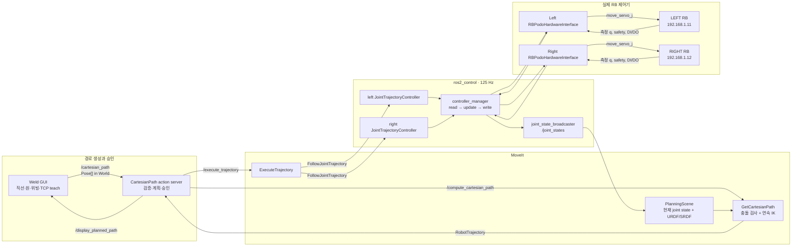
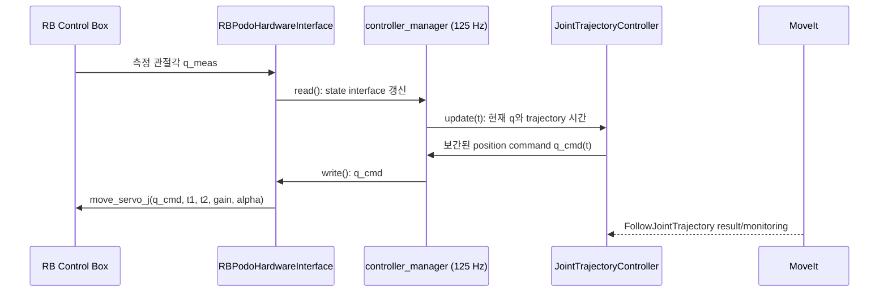
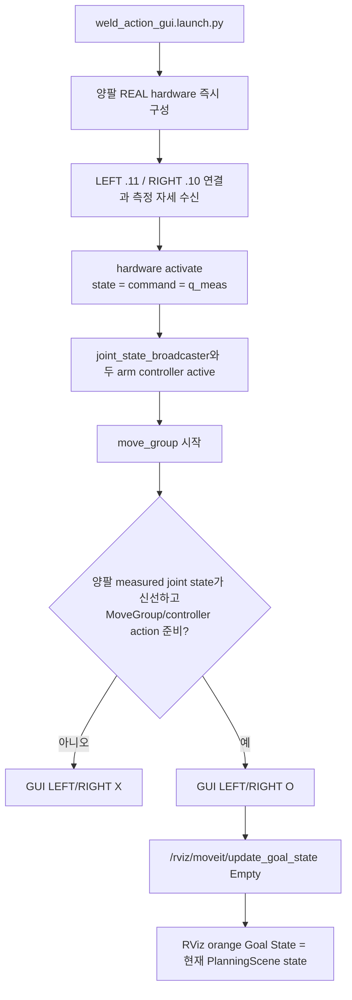

# 경로 생성과 로봇 이동의 수학·제어 흐름

이 문서는 `weld_action_gui`에서 만든 6D TCP 경로가 MoveIt 계획을 거쳐
두 RB 로봇의 관절 명령이 되기까지를 현재 코드 기준으로 설명한다. 좌표의
길이 단위는 m, 관절각은 rad, quaternion 순서는 ROS 표준인 `(x,y,z,w)`다.

## 1. 한눈에 보는 전체 구조

`Plan Preview`는 `CP`까지 수행하고 trajectory를 RViz에 표시한다. 실제
로봇을 움직이는 단계는 승인된 trajectory가 `ExecuteTrajectory`로 전달된
뒤부터다. 정상 실행 경로는 RBPodo의 `move_j`/`move_l` action을 직접 쓰지
않고, hardware interface의 `write()`가 `move_servo_j`를 전송한다.

## 2. 자세와 좌표계

한 TCP 자세는 위치 벡터와 단위 quaternion의 쌍이다.

\[
T = (\mathbf p,\mathbf q),\qquad
\mathbf p=[x\ y\ z]^T,\qquad
\|\mathbf q\|=1
\]

모든 GUI waypoint는 `World` 좌표계로 MoveIt에 전달된다. Tool 축으로 이동할
때는 TCP quaternion에 대응하는 회전행렬 \(R(\mathbf q)\)로 로컬 단위축을
World 방향으로 바꾼다.

\[
\mathbf d_{world}=R(\mathbf q)\mathbf e_{tool}
\]

quaternion의 노름이 0이거나 위치·자세에 NaN/Inf가 있으면 계획 요청 전에
거부한다.

## 3. 경로 생성 수학

### 3.1 World 또는 Tool 축 직선

시작 위치 \(\mathbf p_0\), 이동 거리 \(D\), 점 개수 \(N\)에 대해

\[
s_i=\frac{i}{N-1},\qquad
\mathbf p_i=\mathbf p_0+s_iD\mathbf d,\quad i=0,\ldots,N-1
\]

World 기준이면 \(\mathbf d\)는 World의 X/Y/Z 단위축이고, Tool 기준이면
\(\mathbf d=R(\mathbf q_0)\mathbf e\)다. 이 경로에서는 시작 quaternion을
모든 점에 그대로 유지한다. 음의 거리는 선택 축의 반대 방향 이동이다.

### 3.2 두 TCP 사이의 6D 직선

위치는 선형 보간한다.

\[
\mathbf p(s)=(1-s)\mathbf p_0+s\mathbf p_1,\qquad 0\le s\le1
\]

자세는 두 quaternion의 내적이 음수이면 끝 quaternion의 부호를 뒤집어
같은 회전의 짧은 호를 고른 뒤, 정규화 선형 보간(NLERP)한다.

\[
\mathbf q_1'=
\begin{cases}
-\mathbf q_1,&\mathbf q_0\cdot\mathbf q_1<0\\
 \mathbf q_1,&\text{otherwise}
\end{cases}
\]

\[
\mathbf q(s)=
\frac{(1-s)\mathbf q_0+s\mathbf q_1'}
{\|(1-s)\mathbf q_0+s\mathbf q_1'\|}
\]

현재 구현은 SLERP가 아니라 NLERP다. 계산이 단순하고 연속이지만, 회전
각속도가 수학적으로 완전히 일정하지는 않다.

### 3.3 World-YZ 원

현재 TCP 위치를 중심 \(\mathbf c=(c_x,c_y,c_z)\), 반지름을 \(r\)라 하면

\[
\theta_i=\frac{2\pi i}{N},\qquad
\mathbf p_i=
\begin{bmatrix}
c_x\\c_y+r\cos\theta_i\\c_z+r\sin\theta_i
\end{bmatrix}
\]

`closed`이면 마지막에 첫 점을 한 번 더 붙인다. `TCP +Z faces center`를
켜면 각 점의 TCP Z축은 원 중심을 향한다.

\[
\hat{\mathbf z}_i=(0,-\cos\theta_i,-\sin\theta_i),\quad
\hat{\mathbf x}_i=(1,0,0),\quad
\hat{\mathbf y}_i=\hat{\mathbf z}_i\times\hat{\mathbf x}_i
\]

세 축을 회전행렬의 열로 놓고 quaternion으로 변환한다. 옵션을 끄면 중심
TCP의 quaternion을 모든 점에 유지한다.

### 3.4 가르친 seam 위의 사인 위빙

먼저 입력 polyline의 각 구간 길이와 전체 길이를 구한다.

\[
L_k=\|\mathbf p_{k+1}-\mathbf p_k\|,\qquad L=\sum_k L_k
\]

`cycles × samples_per_cycle + 1`개의 점을 호 길이에 균등하게 재표본화한다.
각 점의 구간 접선 \(\hat{\mathbf t}\)에 대해 사용자가 고른 Tool/World 축
\(\mathbf a\)의 접선 성분을 제거하고 정규화해 횡방향을 만든다.

\[
\mathbf n=
\frac{\mathbf a-(\mathbf a\cdot\hat{\mathbf t})\hat{\mathbf t}}
{\|\mathbf a-(\mathbf a\cdot\hat{\mathbf t})\hat{\mathbf t}\|}
\]

선택 축이 접선과 평행해 분모가 0에 가까우면, 접선과 가장 덜 평행한 축을
자동 선택한다. 진폭 \(A\), cycle 수 \(C\), 정규화 호 길이 \(s\)에 대해

\[
\mathbf p_{weave}(s)=\mathbf p_{seam}(s)
+A\sin(2\pi Cs)\mathbf n(s)
\]

자세는 원본 seam의 인접 자세를 NLERP한 값을 유지한다.

## 4. Cartesian waypoint에서 관절 trajectory까지

GUI의 점들은 곧바로 로봇에 전송되지 않는다. action server가
`GetCartesianPath`에 다음 조건으로 요청한다.

- group: `left_manipulator` 또는 `right_manipulator`
- tip: 해당 arm의 `*_manipulator_ee_point`
- frame: `World`
- `max_step = 0.005 m`
- `jump_threshold = 0.0`
- `avoid_collisions = true`
- start state: PlanningScene이 받은 최신 `/joint_states`

MoveIt은 각 Cartesian 표본에서 전진기구학
\(T=f(\mathbf q)\)을 만족하는 관절값을 연속적으로 찾는다. 국소적으로는
Jacobian \(J(\mathbf q)\)가 TCP 미소변위와 관절 미소변위를 연결한다.

\[
\Delta\mathbf x \approx J(\mathbf q)\Delta\mathbf q,\qquad
\Delta\mathbf q \approx J^+(\mathbf q)\Delta\mathbf x
\]

실제 IK solver는 설정된 KDL plugin이며, 위 식은 동작을 이해하기 위한
배경이다. 각 표본은 joint limit, self-collision, 양팔 상호 collision과
환경 collision을 통과해야 한다. 전체 요구 구간의 비율이 0.999 미만이면
현재 action server는 실행하지 않는다.

### IK branch 전환 검사

MoveIt 2.5(Humble)의 `GetCartesianPath`는 상대 `jump_threshold`만 적용하고
요청의 `revolute_jump_threshold`/`prismatic_jump_threshold`는 무시한다.
특이점 근처에서 seed IK가 실패하면 KDL random restart가 다른 branch(손목 flip,
관절 한 바퀴, elbow 전환)의 해를 찾을 수 있고, 이때도 fraction은 1.000이다.
시간 매개화가 그 관절 점프를 빠른 재구성 동작으로 바꾸므로 관절 간격만으로는
구분되지 않는다. 오프라인 MoveIt에서 120° pitch 재정렬 요청이 fraction 1.000으로
TCP를 2.25–2.90 m, 140–169° 경로 밖으로 보내는 계획을 반복적으로 반환했다.

따라서 action server는 완성된 모든 계획에 대해 JTC가 실제로 보간할 spline
(가속도가 있으면 5차, 속도만 있으면 3차, 그 외 선형)을 조밀하게 표본화하고
`World→TCP` FK로 요청 경로(시작 TCP→waypoint 선형 + 자세 SLERP)와의 위치·자세
편차를 계산한다. `path_deviation_limit_mm`(3 mm) 또는
`path_orientation_limit_deg`(10°)를 넘으면 계획을 거절하고, 모든 계획의 최대
편차를 로그에 남긴다. 실제 계획 기준값은 dwell weave 0.15 mm, dwell 없는 weave
0.44 mm, 직선 0.01 mm, 단일 step 150° 재정렬 3.7°다. GUI node가 직접 요청하는
named TCP 직선 계획도 같은 검사를 거친다
(`core/path_fidelity.py`, `nodes/robot_model.py`).

ARC를 사용할 때는 현재 자세→TCP1 접근과 TCP1→TCP2 seam을 별도 계획하고,
접근 trajectory의 마지막 관절 상태를 seam의 시작 상태로 사용한다. 따라서
두 trajectory의 상태가 수학적으로 이어진다.

## 5. 시간과 속도 스케일

MoveIt이 만든 점의 원래 시간, 속도, 가속도를 각각 \(t,\dot q,\ddot q\),
GUI scale을 \(v\in(0,1]\)라 하면 현재 코드는

\[
t'=\frac{t}{v},\qquad
\dot q'=v\dot q,\qquad
\ddot q'=v^2\ddot q
\]

로 바꾼다. 예를 들어 20%는 수행 시간을 5배로 늘리고 속도를 0.2배,
가속도를 0.04배로 만든다. MoveIt pipeline에는 TOTG 시간 매개화 뒤 Ruckig
jerk smoothing이 설정되어 있다. 별도 GUI scale은 반환된 trajectory에
추가 적용된다.

### TCP 등속 프로파일의 제한 검사

`linear_motion_profile=true`이며 물리 TCP 속도를 지정하면, 활성 URDF의
FK로 각 관절 표본의 실제 TCP 이동 거리를 계산해 등속 구간의 시간을
배정한다. 관절 이동 거리를 TCP 거리 대신 쓰는 fallback은 하지 않는다.
FK를 구할 수 없거나 TCP 이동 없이 회전만 하는 구간이면 계획을 거절한다.

재설정한 궤적은 JTC의 position/velocity/acceleration 입력에 대응하는
구간별 5차 보간 다항식으로 검사한다. 샘플 사이의 최대 관절 속도·가속도·jerk도
포함하며, 제한은 `/move_group/get_parameters`의
`robot_description_planning.joint_limits.*`에서 읽는다. 속도는 URDF 제한과
더 작은 값을 사용한다. 활성 제한을 구할 수 없으면 계획을 승인하지 않는다.
URDF와 제한은 성공적으로 읽은 뒤 캐시하므로 설정 변경 시 서버를 재시작한다.

제한을 초과하면 전체 궤적에 동일한 시간 확대율을 적용한다.
속도는 확대율의 역수, 가속도는 역수의 제곱, jerk는 역수의 세제곱으로
줄어든다. 관절 위치와 경로 순서, TCP 거리 기준의 상대 시간 프로파일은
유지하고, 확대율·낮아진 계획 순항 속도·실제 ramp 시간은 로그에 표시한다.
GUI에서 승인한 최종 궤적을 실행할 때 다시 시간 배정하지 않는다.

이 검사는 명령 궤적의 관절 제한에 대한 검사다. 표본 사이의 FK 비선형성,
현재 상태에서 궤적 시작점으로의 연결, 실제 RB Servo-J 추종 오차까지
TCP 등속으로 보장하는 것은 아니다. 실제 용접 속도는 측정 궤적과 비교해
확인한다. 기존 위빙 드웰 구간과 S-curve 모드의 시간 배정은 유지한다.

## 6. ros2_control 폐루프

controller manager의 주기는 125 Hz다(`ros2_controllers.yaml` `update_rate`). 두 arm controller는 position command와
실제 position state를 쓰며 `open_loop_control: false`다. partial joint goal은
허용하지 않는다. 설정된 허용오차는 각 관절 trajectory 0.15 rad, goal
0.02 rad, goal time 2 s다.

hardware의 상태 수집 thread는 500 Hz를 목표로 하고, arm별 `system_state`는
약 10 Hz로 GUI에 발행된다. `/joint_states`는 controller loop를 따라 MoveIt,
robot_state_publisher와 RViz에 전달된다.

시작할 때 임의의 YAML 초기 관절각을 명령하지 않는다. hardware activation이
RB의 측정 관절각을 state와 command 양쪽에 먼저 복사하므로 최초 command가
현재 자세와 일치해야 한다. 이후에만 trajectory controller가 시간에 따른
명령을 만든다.

### 6.1 키보드 조깅 스트림 (servo backend)

`keyboard_jog_node`는 JTC를 active로 둔 채 `/<arm>_manipulator_controller/
joint_trajectory` topic으로 짧은 trajectory를 계속 보낸다. JTC 2.x는 stamp가
0인 메시지를 첫 sample 시각에 "직전 command"에 고정하므로, 메시지마다 한
제어 주기(8 ms) 동안 command가 멈췄다가 따라잡는다(32 ms 메시지에서 속도
0 → 1.33v 반복). 실제 프로세스 측정에서 50 mm/s 유지 중 200 주기 가운데
49 주기가 정지, 최대 122 mm/s였다.

현재 스트림은 각 메시지에 stamp를 붙이고, 0번 점을 노드가 직전에 보낸
spline을 그 stamp에서 JTC와 같은 3차 Hermite로 평가한 위치·속도로 둔다.
JTC는 메시지 점들 사이를 sample하므로 경계에서 끊김이 없다(같은 측정에서
49.99–50.00 mm/s, 정지 주기 0). 점 구성은 현재 → 다음 command(8 ms, JTC 한 주기) →
같은 속도로 한 주기 → 0.1 s 감속 정지이며, 노드가 멈추면 JTC는 감속 꼬리를
따라 부드럽게 선다. twist가 바뀌면(누름·뗌·방향 전환) 다음 주기를 기다리지
않고 즉시 보낸다. JTC reference가 스트림에서 3 mrad 이상 벗어나면(tolerance
hold 등) reference에서 다시 시작한다.

물리 방향키 눌림은 GUI node의 ROS thread가 Tk queue를 거치지 않고 바로 jog
명령으로 바꾼다(Tk 경로는 9–58 ms 지연이 측정됨). 활성화·포커스·축·속도 같은
interlock은 Tk가 10 ms마다 갱신하는 context로 전달되며, 1.0 s보다 오래된
context로는 새 jog를 시작하지 않는다. 떼는 순간의 0 명령은 원래대로 ROS
thread가 즉시 보낸다.

방향키 입력은 X11 keymap을 전용 thread가 2 ms(500 Hz)마다 읽어 바뀐 순간
발행한다(변화 없으면 10 Hz heartbeat). GUI 프로세스에서는 `/joint_states`와
키보드 입력이 각각 작은 전용 node·executor thread에서 처리된다. 수십 개의
client/action client를 가진 GUI node executor는 깨어날 때마다 wait set을 다시
만들어 125 Hz `/joint_states`만으로 CPU 약 40%를 쓰며 GIL을 잡고 있었고, 이것이
Tk와 키보드 경로를 지연시켰다. Fastech `/touch/contact`·`/fastech/io_state`는
바뀔 때 즉시 + 0.5 s heartbeat로만 발행하고(이전 100 Hz), 키보드 bridge의
`controller_state`는 `/joint_states`를 처리하는 작은 node에서 받으며, 키보드
teaching 중에만 reference를 갱신한다. 구독은 최초 활성화 후 유지해 실행 중
구독 제거로 executor가 멈추는 문제를 피한다. 이전 재현 부하에서 GUI
프로세스 CPU 92% → 56%, Tk 지연 p95 29 → 7 ms, 방향키 → twist median 3.4 ms.
`keyboard_jog_node` 스트림 timer는 키보드 teaching 중에만 돈다.

Twist 송수신, JTC trajectory 송신, 조그용 controller reference 수신 큐는
최신 1개만 유지한다. stamped Twist는 수신 시각이 아닌 발행 시각 기준으로
0.2 s watchdog을 적용하며, 이미 처리한 명령보다 오래되거나 활성화 이전에
발행된 명령은 실행하지 않는다. 따라서 지연된 비영점 명령이 키 해제 후
다시 움직임을 시작하거나 watchdog 시간을 늘리지 않는다. stamp가 없는
기존 입력은 수신 시각 기준 watchdog을 유지한다. 전달 지연 40 ms 초과와
스트림 주기 지연 max(3주기, 40 ms) 초과는 각각 경고로 기록된다.

`V` 속도 전환도 물리 키 누름마다 ROS 입력 thread에서 처리한다
(5 → 15 → 45 → 5 mm/s). 기존처럼 진행 중인 조그에는 즉시 0 명령을 보내고,
방향키를 다시 눌러야 새 속도로 움직인다. Tk는 이미 선택된 값을 표시하며,
갱신 확인 전의 오래된 GUI context가 새 속도를 덮어쓰지 않도록 세대 번호를
사용한다. 키를 누른 채 유지하면 한 번만 전환하고, 실제로 떼었다 다시 누르면
50 ms 재입력 지연 없이 다시 전환한다. 물리 입력 노드가 없으면 기존 Tk
단축키 처리를 사용한다. 반영에는 GUI와 `keyboard_teaching_node` 재시작이 필요하다.

### 6.2 GUI 갱신 비용

양팔 `system_state`도 작은 joint-state node에서 최신 1개씩 처리한다.
수신할 때마다 연결·모션 상태는 갱신하지만, 동일한 Rainbow I/O 값으로
화면 갱신을 반복 예약하지 않는다. Tk bridge는 일반 이벤트와 최신 상태
갱신에 각각 2 ms의 처리 예산을 주고, 남은 작업은 다음 bridge 주기로 넘긴다.
개별 callback 실행은 중간에 끊을 수 없으므로 긴 callback 하나는 이 예산을
넘을 수 있다. 키 입력 bridge의 10 ms 주기는 유지한다.

용접 설정 비교표는 로그 경로·inode·크기·수정 시각·변경 시각이 바뀔 때만
로그를 다시 읽으며, 바뀐 셀만 수정해 스크롤과 그룹 펼침 상태를 유지한다.
1G/3G 전환, 로그 교체·삭제·재생성도 캐시를 갱신한다. 이 최적화는 표시용이며
원본 용접 로그나 제어·센서 수집 주기를 바꾸지 않는다.

## 7. 시작·연결·RViz 동기화

O/X는 단순 ping 결과가 아니다. `/joint_states`에 해당 arm의 유효한 6축
측정값이 모두 있고 `/move_action`, 실행 모드의 `FollowJointTrajectory`
action이 준비되어야 O다. `system_state`는 touch DI와 상세 상태 감시에 쓴다.
RViz Goal State 갱신용 Empty 메시지는 표시 상태만 바꾸며 trajectory 실행을
요청하지 않는다.

이 사용자 launch는 ros2_control, MoveIt, RViz와 GUI의 Fast DDS transport를
모두 `UDPv4`로 통일하고 `ROS_LOCALHOST_ONLY=1`로 loopback에 고정한다.
shared-memory lock 장애와 유선·Wi-Fi NIC 분산으로 endpoint만 발견되고 실제
topic/service 데이터가 멎는 상태를 방지한다. RB/Hi-COMM의 별도 TCP에는 영향을
주지 않는다.

## 8. 통신 경계와 고장 해석

| 구간 | 인터페이스 | 끊기면 보이는 현상 |
|---|---|---|
| RB 상태 → hardware | RBPodo 상태 TCP | `system_state` stale, GUI X, `/joint_states` 정지 가능 |
| MoveIt → controller | `FollowJointTrajectory` action | plan은 되지만 execute 거부/실패 |
| controller → hardware | ros2_control position interface | controller active여도 실제 명령 전달 불가 |
| hardware → RB | RBPodo command TCP, `move_servo_j` | connection lost, pendant external-command 상태 소실 |
| joint state → MoveIt | `/joint_states` | 현재 state 불명, planning start state 오류 |

주황색 pendant 표시는 보통 외부 servo 명령 상태와 관련 있지만, GUI의 O와
동일한 신호는 아니다. GUI O는 ROS stack 준비 상태까지 포함하고, pendant는
RB 제어기 내부 상태를 보여준다.

실행 전에는 다음 세 조건을 따로 확인해야 한다.

1. **현재 상태:** 양팔 `/joint_states`와 `system_state`가 계속 갱신된다.
2. **계획:** path fraction이 0.999 이상이고 collision/joint limit 오류가 없으며,
   명령 spline의 TCP 편차가 3 mm / 10° 이내다(IK branch 전환 없음).
3. **실행:** 두 arm controller가 active이고 승인한 trajectory와 현재 상태의
   시작 오차가 허용 범위 안이다.

## 9. 구현 위치

| 기능 | 파일 |
|---|---|
| 직선·원·위빙·자세 보간·속도 scale | `construct_robot/core/cartesian_path_common.py` |
| MoveIt 계획, 승인 trajectory 보관, 실행 | `construct_robot/nodes/cartesian_path_server.py` |
| 명령 spline의 TCP 경로 편차, IK branch 전환 거절 | `construct_robot/core/path_fidelity.py`, `construct_robot/nodes/robot_model.py` |
| 키보드 조깅 스트림 | `construct_robot/nodes/keyboard_jog_node.py`, `construct_robot/nodes/weld_runtime_node.py` |
| GUI, TF pose 취득, 연결 O/X, RViz Goal 갱신 | `construct_robot/gui/weld_action_gui.py` |
| 상단 상태 표시줄(연결·조깅·오류·STOP), 이벤트 로그 | `construct_robot/gui/status_bar.py` |
| controller 주기와 오차 설정 | `construct_moveit_config/config/ros2_controllers.yaml` |
| planning adapter | `construct_moveit_config/config/ompl_planning.yaml` |
| hardware plugin 선택과 joint interface | `construct_description/urdf_0528/construct_robot_0528.ros2_control.xacro` |
